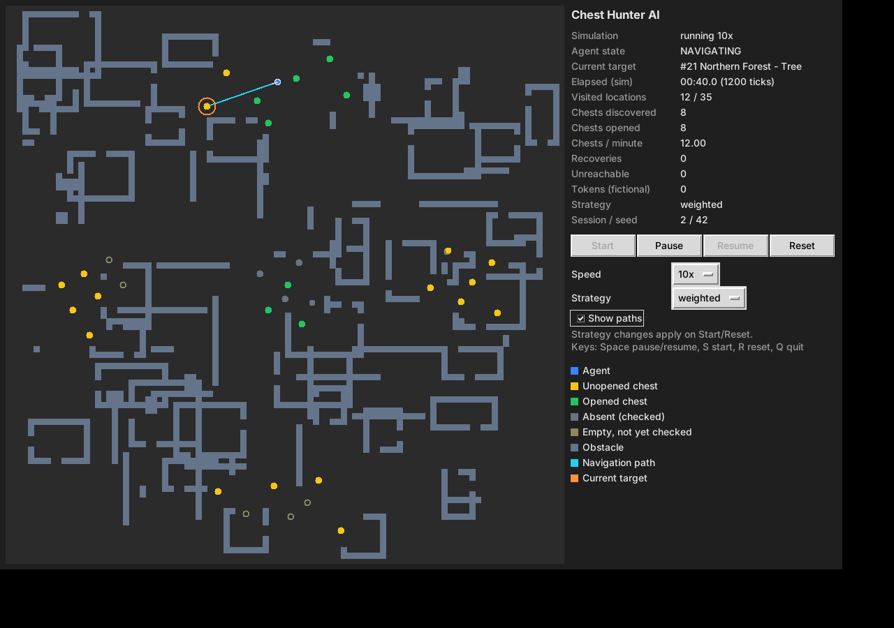
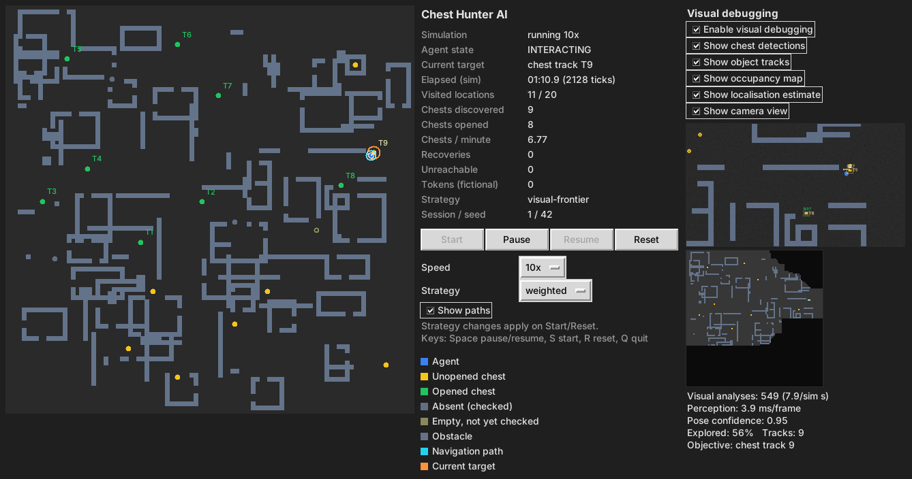

# chest-hunter-ai

A lightweight research project: an **autonomous agent that navigates a
controlled 2D research environment, finds simulated chests, opens them, and
tries to maximise chests opened per minute.**

| Phase | Status | What it provides |
|---|---|---|
| 1. Data foundation | Done | SQLite database of chest spawn points, simulation sessions and observations; CLI; tests |
| 2. Autonomous navigation | Done | Grid-world simulator, A* pathfinding, route planning, continuous movement, 10-state agent, Tkinter GUI, headless runs, benchmarking |
| 3. Computer vision and visual navigation | Done | Simulated camera, OpenCV chest/obstacle/prompt detection, object tracking, visual localisation, occupancy mapping, frontier exploration, closed-loop interaction with visual verification, debug overlays, oracle-vs-visual benchmark |

> The simulator is entirely self-contained. The project never talks to a game
> client, game service or network. It never reads or writes game memory or
> injects into processes, never sends keyboard or mouse input to other
> applications, and contains no anti-cheat evasion. The demo map is a
> **fictional** research arena, and its coordinates are not real game data.
> Phase 3 "camera frames" are images the simulator draws for itself. The
> project never captures the screen or windows of any other application.



## Quick start

```bash
cd chest-hunter-ai
python -m venv .venv && source .venv/bin/activate     # Windows: .venv\Scripts\activate
python -m pip install -e .

python -m chest_hunter init-db
python -m chest_hunter seed-demo

# Watch the agent (needs Tkinter and a display):
python -m chest_hunter simulate --render

# Or run without a window and print statistics:
python -m chest_hunter simulate --map research_arena_01 --strategy weighted --seed 42 --headless

# Compare strategies on 100 paired episodes:
python -m chest_hunter benchmark --episodes 100 --strategies nearest,weighted

# Phase 3: the vision-based agent on the 20-location acceptance arena
python -m chest_hunter seed-demo --scenario visual_arena
python -m chest_hunter simulate --map visual_arena_01 --agent visual --seed 42 --render
python -m chest_hunter simulate --map visual_arena_01 --agent visual --seed 42 --headless
python -m chest_hunter benchmark-vision --map visual_arena_01 --episodes 100 --seed 42

python -m unittest discover -s tests -v
```

---

## 1. Scope

**In scope:** a controlled 2D grid world built from the Phase 1 chest
locations; procedural obstacles; seeded chest spawns; an autonomous agent that
selects targets, plans A* routes, moves continuously with acceleration
limits, detects absent chests, opens present ones, records every outcome in
SQLite and recovers from problems; GUI and headless execution; paired
benchmarks.

**Phase 3 adds** a vision-based agent that sees the world only through
simulated camera frames (section 14). It uses classical computer vision
(OpenCV + NumPy) on the CPU.

**Still out of scope:** neural networks and other machine learning (including
reinforcement learning), large language models, GPU use and external APIs.

**Never in scope:** live-game automation, matchmaking bots, memory reading,
process injection, input simulation for third-party software, and detection
evasion. Movement looks natural only because of continuous steering and
acceleration. Nothing imitates human input timing.

## 2. Architecture

```text
 cli.py  ──────────────┬───────────────────────────────┬──────────────────────────┐
 (Phase 1 commands)    │ simulate --headless/--render   │ benchmark                │
                       ▼                               ▼                          ▼
              agent/runner.py  SimulationRunner  ◄── simulation/renderer.py   analytics/benchmark.py
              (session + run rows, clock, loop)       (Tkinter, after() loop)  (paired episodes, CSV)
                       │
                       ▼
              agent/controller.py  AgentController (finite-state machine)
                 │            │                 │                     │
                 ▼            ▼                 ▼                     ▼
   navigation/route_planner  navigation/astar  navigation/movement   agent/recorder
   (nearest/weighted/        (A*, path cache,  (smoothing, steering,  (batched observations,
    lookahead scoring)        distance fields)  arrival, stuck)        simulated timestamps)
                 └──────────────┬───────────────────┘                     │
                                ▼                                         ▼
   simulation/environment (World, Environment, spawns, interaction,   Phase 1 repositories
   rewards) · map_generator · collision (GridMap) · entities          (chest, session, run)
                                                                          │
                                                                          ▼
                                                        data/chest_locations.db (SQLite)
```

Design rules:

* **Deterministic.** The simulator uses a fixed timestep (default 1/30
  simulated second) and never reads the wall clock for physics. Every random
  decision uses `random.Random` seeded from `(seed, episode, chest id)`. The
  same inputs give the same episode in headless and GUI mode, at any speed.
* **Plan rarely, move every tick.** A* runs only when a target is selected, a
  path is blocked, the agent is stuck, or the map changes. Paths are cached
  per grid version. Target scoring uses precomputed shortest-path distance
  fields, so choosing among N chests costs N array lookups.
* **No database work on ordinary ticks.** Each session makes one candidate
  query when it starts, writes observations in batches, and finalises once.
  Tests verify that navigation ticks issue zero SQL statements.
* **GUI is optional.** The renderer only drives a runner it is given. Headless
  runs never import Tkinter (also tested).
* **Small dependency footprint.** Phases 1-2 use only the standard
  library. Phase 3 adds NumPy and `opencv-python-headless` (CPU only, no GUI
  backend). They are imported only when a visual agent runs, so headless
  oracle runs, the database commands and the Phase 2 benchmark never load
  them (tested).

### Source layout

```text
chest-hunter-ai/
├── pyproject.toml, README.md, .gitignore
├── config/settings.json          # all settings (Phases 1-3)
├── assets/templates/             # chest, prompt, obstacle and agent templates + palette.json
├── benchmark_results/            # Phase 3 benchmark outputs (CSV + summary.json)
├── data/                         # SQLite DB + Phase 2 benchmark CSVs (git-ignored)
├── docs/gui_screenshot.png, docs/visual_debug_screenshot.png
├── scripts/seed_demo_chests.py, scripts/generate_templates.py
├── src/chest_hunter/
│   ├── cli.py, config.py, database.py, models.py, exceptions.py, logging_config.py
│   ├── chest_repository.py, session_repository.py, run_repository.py, demo_data.py
│   ├── scenarios.py                                    # Phase 3 acceptance arena
│   ├── simulation/   environment.py, map_generator.py, entities.py, collision.py, renderer.py,
│   │                 camera.py, sprites.py, interface.py # Phase 3: frames + action interface
│   ├── vision/       observation.py, preprocessing.py, templates.py, chest_detector.py,
│   │                 obstacle_detector.py, interaction_detector.py, visual_tracker.py,
│   │                 perception_pipeline.py
│   ├── localization/ pose_estimator.py, world_state.py
│   ├── navigation/   astar.py, route_planner.py, movement.py, visual_planner.py, local_controller.py
│   ├── agent/        fsm.py, controller.py, visual_controller.py, states.py, objectives.py,
│   │                 recorder.py, runner.py
│   └── analytics/    metrics.py, benchmark.py, vision_metrics.py, visual_benchmark.py
└── tests/  (20 modules, 316 tests)
```

Additions beyond the requested layout: `run_repository.py` (records the
strategy and seed used by every simulation session), `agent/recorder.py`
(batched observation writes and the simulated clock), `agent/runner.py` (one
runnable episode shared by headless mode, the GUI and the benchmark) and
`tests/test_movement.py`, `tests/test_renderer.py`.

## 3. Hardware requirements and measured performance

Any computer that runs Python 3.11+ is enough. No GPU is used. Measured on a
4-vCPU Intel Xeon 2.1 GHz cloud VM:

| Measurement | Target | Measured |
|---|---|---|
| Headless simulation speed (demo episode, 4,120 ticks) | >= 500 ticks/s | 78,000-128,000 ticks per CPU-second |
| Headless speed including SQLite writes (benchmark average) | - | 59,000-103,000 ticks per CPU-second |
| One-off map setup (generate map + 34 distance fields) | - | 0.55-0.77 s per map |
| GUI simulation rate at 1x | 30 ticks/s | 29.4 ticks/s, 14.7 frames/s (target 15), 1.4% of one CPU core |
| Memory for simulation logic (world, distance fields, episode) | < 100 MB | ~3 MiB Python heap; process RSS grew by 3.6 MiB |
| One full demo episode, headless | - | ~0.05 s CPU after setup |

Phase 3 visual agent, same machine. Acceptance arena `visual_arena_01`, seed
42, one camera frame analysed per perception step:

| Measurement | Measured |
|---|---|
| Full visual episode, headless, 640x360 | 160.1 simulated s in 6.4 CPU s, so about **25x faster than real time** (~750 ticks per CPU-second) |
| Perception steps per episode | 1,210 analyses, 7.6 per simulated second (the rate adapts: 2/s while travelling, 5/s exploring, 10/s near a target or while verifying) |
| Perception time per analysis (detection, marker, occupancy, prompt and progress cues) | 640x360: 3.5 ms mean, 6-9 ms peak · 320x180: 1.4 ms · 480x270: 2.3 ms · 800x450: 5.0 ms |
| Same episode at each resolution | all four open 15 of 15 reachable chests: 320x180 in 162.7 s (60x real time), 480x270 in 140.0 s (35x), 640x360 in 160.1 s (25x), 800x450 in 146.3 s (16x) |
| Memory | Python heap peak 27 MiB during an episode (frames, templates, occupancy grid, tracks). Process RSS 90 MiB after one episode, of which 29 MiB is the OpenCV/NumPy libraries |
| GUI at 1x with every debug overlay on | 26.8 ticks/s (target 30) and 13.4 frames/s (target 15) at 9% of one core. The shortfall is Tk timer scheduling, not CPU. The GUI and headless runs give identical results |

The CPU budget is single-threaded: `cv2.setNumThreads(1)` is set because
OpenCV's thread pool cost more than it saved on these small frames.

## 4. Supported operating systems

* **Linux:** tested with Python 3.11, 3.12 and 3.13. The GUI was tested with
  Python 3.12 + Tk 8.6 under Xvfb.
* **macOS, Windows 10/11:** expected to work but not tested yet. The code is
  pure Python using `pathlib`, with ASCII-only console output. NumPy and
  `opencv-python-headless` publish wheels for all three platforms.

The GUI needs Tkinter. It ships with the python.org installers for Windows
and macOS; on Debian/Ubuntu install `python3-tk`. Headless mode, the
benchmark and every other command work without Tkinter.

## 5. Installation

```bash
python3.11 -m venv .venv          # any Python >= 3.11
source .venv/bin/activate         # Windows PowerShell: .venv\Scripts\Activate.ps1
python -m pip install --upgrade pip
python -m pip install -e .        # editable install; pulls numpy + opencv-python-headless
```

Dependencies: Phases 1-2 need only the standard library. Phase 3 adds
`numpy>=1.26` and `opencv-python-headless>=4.8` (no GPU, no GUI backend; the
GUI uses Tkinter). Without installing, `pip install numpy
opencv-python-headless` and prefix commands with `PYTHONPATH=src`.

This installs the `chest_hunter` package and a `chest-hunter` console
command, so `chest-hunter ...` is equivalent to `python -m chest_hunter ...`.
Without installing, prefix commands with `PYTHONPATH=src`.

## 6. Running the agent

**GUI**

```bash
python -m chest_hunter simulate --render                    # default map/strategy/seed
python -m chest_hunter simulate --render --strategy nearest --seed 7 --speed 5
```

The window opens and the agent starts immediately. Controls:

* **Buttons:** Start, Pause, Resume, Reset.
* **Speed:** 1x, 2x, 5x or 10x. Faster speeds run more fixed ticks per
  frame, so the results are identical at any speed.
* **Strategy:** applied on the next Start or Reset.
* **Show paths:** toggles the navigation path.
* **Keys:** Space pauses or resumes, S starts, R resets, Q or Escape quits.

Closing or resetting a running episode aborts its session. When the window
closes, the terminal prints the statistics of the last finished episode.

**Headless**

```bash
python -m chest_hunter simulate --map research_arena_01 --strategy weighted --seed 42 --headless
python -m chest_hunter simulate --strategy lookahead --episode 3 --max-ticks 1800
```

| Option | Meaning | Default |
|---|---|---|
| `--map` | map whose enabled chest locations are loaded | `simulation.default_map` |
| `--strategy` | `nearest`, `weighted` or `lookahead` | `navigation.default_strategy` |
| `--seed` | seed for obstacles, spawns, failures and rewards | `simulation.default_seed` |
| `--episode` | different chest spawns on the same map | 0 |
| `--max-ticks` | stop after N ticks (outcome `tick_limit`) | `simulation.max_ticks` |
| `--speed` | initial GUI speed (1, 2, 5, 10). Headless runs are never throttled | 1 |
| `--agent` | `oracle` (Phase 2, perfect map knowledge), `visual` (Phase 3, camera only) or `chest-vision` (camera for chests, true obstacle map) | `oracle` |
| `--headless` / `--render` | no window (default) / Tkinter window | headless |

`simulate` exits with 0 when the episode completes or hits the tick limit,
and with 1 if the agent fails or an error occurs.

## 7. Configuration

`config/settings.json` holds every setting. Phase 1 keys are required. Every
Phase 2 key is optional and defaults to the values below, so Phase 1 config
files still load. Unknown keys inside a known section are rejected (typos),
and values are range-checked.

| Key | Default | Unit / meaning |
|---|---|---|
| `simulation.map_width`, `map_height` | 100 | grid cells (10-1000) |
| `simulation.cell_size` | 8 | screen pixels per cell (GUI only) |
| `simulation.world_units_per_cell` | 10.0 | database coordinate units per cell (demo arena: 1000 units = 100 cells) |
| `simulation.tick_rate` | 30 | fixed ticks per simulated second |
| `simulation.render_rate` | 15 | GUI frames per real second |
| `simulation.default_seed` | 42 | seed for map, spawns, failures and rewards |
| `simulation.max_ticks` | 100000 | tick budget per episode (~55 simulated minutes) |
| `simulation.player_speed` | 5.0 | cells per simulated second |
| `simulation.player_acceleration` | 12.0 | cells/s² (also used for braking) |
| `simulation.player_radius` | 0.3 | cells (collision circle, below 0.5) |
| `simulation.agent_start` | `null` | `[x, y]` in database units; `null` = map centre |
| `simulation.interaction_radius` | 1.5 | cells; the agent must be this close **with line of sight** |
| `simulation.chest_interaction_seconds` | 2.0 | simulated seconds to open a chest |
| `simulation.interaction_failure_probability` | 0.0 | chance (0-1) that an attempt fails, to exercise recovery |
| `simulation.reward_probability` | 0.0 | chance (0-1) of a fictional token per opened chest (try 0.1 in testing) |
| `simulation.obstacle_density` | 0.12 | target fraction of blocked cells (0-0.4) |
| `navigation.allow_diagonal` | true | 8-directional movement (otherwise 4-directional) |
| `navigation.prevent_corner_cutting` | true | diagonal moves need both side cells free |
| `navigation.cache_paths` | true | cache A* results for the static map |
| `navigation.default_strategy` | `weighted` | `nearest`, `weighted` or `lookahead` |
| `navigation.stuck_timeout_seconds` | 5.0 | simulated seconds without progress before recovering |
| `navigation.smooth_paths` | true | line-of-sight shortcutting of A* paths |
| `navigation.lookahead_depth` | 2 | chests per sequence for `lookahead` (1-3) |
| `agent.max_recovery_attempts` | 3 | recoveries per target before abandoning it |
| `agent.arrival_tolerance` | 0.5 | cells inside `interaction_radius` where the agent aims to stop |
| `agent.observation_batch_size` | 10 | observations per SQLite transaction |

Phase 3 sections (all optional, with the defaults shown, so Phase 1-2
config files still load):

| Key | Default | Unit / meaning |
|---|---|---|
| `simulation.decoration_density` | 0.004 | fraction of free cells holding gold-coloured decoy props (false-positive bait) |
| `vision.enabled` | true | `false` refuses to start the `visual` and `chest-vision` agents |
| `vision.default_width`, `default_height` | 640, 360 | camera frame in pixels: 320x180, 480x270, 640x360 or 800x450 |
| `vision.view_width_cells` | 40 | grid cells across the frame; width must be a multiple (640 / 40 = 16 pixels per cell) |
| `vision.detector` | `hybrid` | chest detector: `color`, `template` or `hybrid` (section 14.4) |
| `vision.confidence_threshold` | 0.85 | minimum template-matching score (0-1) |
| `vision.max_tracks` | 100 | upper bound on remembered object tracks |
| `vision.track_expiration_seconds` | 3.0 | simulated seconds an **in-view** track may go undetected before it expires |
| `vision.track_memory_seconds` | 600.0 | simulated seconds an out-of-view track is remembered |
| `vision.use_regions_of_interest` | true | search for the agent marker near its predicted position first (`false` = whole frame) |
| `vision.noise_std` | 6.0 | per-pixel Gaussian camera noise (0-255 intensity levels) |
| `vision.lighting_variation` | 0.08 | per-frame brightness change, ± fraction |
| `vision.frame_dropout` | 0.0 | probability (0-0.9) that a capture fails |
| `vision.rate_travel`, `rate_explore`, `rate_tracking`, `rate_verify`, `rate_idle` | 2, 5, 10, 10, 1 | analyses per simulated second in each situation |
| `vision.template_dir` | `assets/templates` | template images and `palette.json` |
| `localization.smoothing_alpha` | 0.4 | weight of a new visual fix against the motion prediction (0-1) |
| `localization.max_missing_observations` | 5 | consecutive frames without the marker before localisation is lost |
| `localization.min_confidence` | 0.5 | below this pose confidence the agent stops and re-observes |
| `localization.dead_reckoning_seconds` | 2.0 | seconds without a fix until pose confidence reaches 0 |
| `visual_navigation.exploration_strategy` | `frontier` | exploration method (`frontier` is the only one implemented) |
| `visual_navigation.replan_on_obstacle_discovery` | true | replan when a newly seen wall blocks the current path |
| `visual_navigation.maximum_recovery_attempts` | 3 | recoveries per target before it is marked failed or abandoned |
| `visual_navigation.use_spawn_priors` | true | spawn points attract frontier exploration (`false` = pure frontier search; spawn points are still resolved when seen) |
| `visual_navigation.prior_weight` | 300.0 | information-gain units per unit of spawn probability |
| `visual_navigation.stop_when_spawn_points_resolved` | true | finish once every spawn point is resolved, instead of exploring the whole map |
| `visual_navigation.unknown_cell_cost` | 0.5 | extra A* cost for entering an unexplored cell |
| `visual_navigation.empty_confirmations` | 2 | in-view analyses without a chest before a spawn point counts as empty |
| `visual_debug.enabled`, `show_detections`, `show_object_tracks`, `show_occupancy_grid`, `show_localization`, `show_camera_view` | true, true, true, false, true, true | initial state of the GUI debug toggles |

Overrides: `--config PATH` or `CHEST_HUNTER_CONFIG`, `--db PATH`,
`--log-level LEVEL`, `CHEST_HUNTER_HOME`. Relative paths resolve against the
project root, never the current directory.

## 8. The simulator

* **World mapping.** Each enabled chest location from SQLite is placed at
  `(x, y) / world_units_per_cell`; `z` is ignored in 2D. Locations outside
  the grid are excluded and listed in the run's parameters. Grid `y` points
  north and the renderer flips it.
* **Map generation** (`map_generator.py`). The generator is deterministic
  per seed. It builds walls one cell thick with two doorways, wall segments
  and 1x1-3x3 rocks until `obstacle_density` is reached. It keeps a walkable
  one-cell border, and a 5x5 obstacle-free zone around every chest and the
  start. Obstacles are rectangles rasterised into a `bytearray` grid.
* **Spawning.** At the start of each episode a chest exists with its
  location's `spawn_probability`. Over 5,000 samples at p = 0.3 the observed
  frequency was within ±0.03 (tested). Presence depends only on
  `(seed, episode, chest id)`, so every strategy sees identical spawns.
* **Interaction.** A chest opens only if it exists, is not already open, the
  agent is within `interaction_radius` with line of sight, and
  `chest_interaction_seconds` have elapsed. Presence is only perceived from
  within range: the agent never knows in advance which spawn points are
  empty.
* **Fictional rewards.** A separate `TokenRewardModel` rolls
  `reward_probability` after each successful opening. It is a synthetic
  signal for testing reward reporting and says nothing about any real game.
* **Episode reset.** `Environment.reset(episode)` respawns chests, restores
  the agent, resets the clock and drops any obstacles added at runtime.

## 9. The autonomous agent

| State | What happens |
|---|---|
| `INITIALIZING` | The runner opens a SQLite session and a `simulation_runs` row, loads candidate locations (`get_unvisited_chests`) and spawns the episode |
| `SELECTING_TARGET` | Scores pending candidates. Unreachable ones are marked and reported. Moves to COMPLETED when nothing is left |
| `PLANNING_ROUTE` | A* from the agent's cell to the target, then smoothing. Goes straight to VERIFYING if already in range; an A* failure marks the target unreachable |
| `NAVIGATING` | Continuous steering along waypoints. Detects arrival, being stuck, and paths invalidated by new obstacles |
| `VERIFYING_CHEST` | Perceives presence. An empty spot is recorded as an observation and the agent moves on |
| `INTERACTING` | Brakes and holds position for `chest_interaction_seconds`. Leaving range means recovery |
| `CONFIRMING_OPEN` | A success is recorded (opened, duration), with a reward roll. A failure is recorded as a failed interaction and leads to recovery |
| `RECOVERING` | Bounded: retry the interaction or replan from the current position. Abandons the target after `max_recovery_attempts`. Whole-episode budget: (attempts + 1) x candidates |
| `COMPLETED` | Flushes observations, completes the session and run row, stops the agent |
| `FAILED` | Records the reason, aborts the session safely |

Safety against endless loops: at most 16 state transitions per tick, bounded
recoveries per target and per episode, and the tick limit. Every transition
is checked against an explicit table (`agent/states.py`).

**Movement** (`navigation/movement.py`):

* **Waypoints.** A* cell paths are shortened by line-of-sight smoothing that
  accounts for the agent's radius.
* **Steering.** Desired velocity is limited by `player_speed`, by the turn
  angle at the next waypoint (the agent slows for sharp corners) and by a
  braking profile `v = sqrt(2·a·d)`. Velocity changes are capped at
  `acceleration × dt`.
* **Waypoint progress.** A waypoint counts as passed once the agent crosses
  the line through it, which prevents oscillating around it.
* **Arrival.** The agent stops inside the interaction radius, not on top of
  the chest.
* **Collisions.** Circle-versus-grid collision with axis-separated sliding.
  Tests confirm the agent never overlaps an obstacle on any tick of a full
  demo episode.
* **Stuck detection.** No progress along the remaining path for
  `stuck_timeout_seconds` triggers recovery.

## 10. Route planning

For each reachable candidate *i* (Q_i = 1; unreachable ones get Q_i = 0 and
are excluded):

```text
T_i = path_length_i / player_speed + player_speed / acceleration + P_i · estimated_open_seconds_i
S_i = P_i · Q_i / T_i
```

* **Path length.** `path_length` is the shortest-path cost (identical to
  A*'s cost; tested), never straight-line distance.
* **Leg overhead.** The `speed / acceleration` term is the time lost
  accelerating away and braking on each leg.
* **Interaction time.** The interaction term is the expected time: an empty
  spot costs no interaction time.
* **Estimates vs truth.** `P_i` and `estimated_open_seconds_i` come from the
  database. These are the agent's estimates, while the simulator's true
  opening time is `chest_interaction_seconds`.

| Strategy | Rule |
|---|---|
| `nearest` | minimum travel time (ties: lower chest ID) |
| `weighted` | maximum S_i (expected openings per second) |
| `lookahead` | short-horizon cluster planning: for each first chest, the best rate ΣP / ΣT over sequences of up to `lookahead_depth` chests (beam of 8), then pick the best first chest |

The plan is recalculated after every observation. The strategy, seed,
episode and all parameters are stored in `simulation_runs` for every
session.

## 11. Database structure (schema version 2)

Phase 1 tables are unchanged. Migration 2 adds one table and
`python -m chest_hunter init-db` upgrades a Phase 1 database in place. Every
command except `init-db` also applies pending migrations automatically.
Existing data is preserved (tested).

* **`chest_locations`**: possible spawn points. Columns: `map_id`,
  `location_name`, `x`, `y`, `z`, `spawn_probability` (0-1),
  `estimated_open_seconds` (>= 0), `enabled`, and UTC timestamps.
  `UNIQUE (map_id, x, y, z)`. There is no `visited` column.
* **`simulation_sessions`**: one per run, `running -> completed | aborted`.
  Final states are immutable (trigger).
* **`chest_observations`**: one row per visit outcome: `chest_present`,
  `chest_opened`, `interaction_seconds`, `observed_at`. Enforced rules:
  opened requires present, the session must be running and on the same map,
  and there is at most one successful opening per location per session.
* **`simulation_runs`** (new): one row per agent-driven session. Columns:
  `strategy`, `seed`, `episode`, `parameters_json` (every simulation,
  navigation and agent setting used, plus `time_basis: "simulated"`),
  `outcome` (`completed`, `tick_limit`, `failed` or `cancelled`),
  `failure_reason`, `ticks`, `simulated_seconds`, `travel_distance` (cells),
  `recoveries`, `unreachable_targets`, `abandoned_targets`, `rewards`, and
  timestamps. A finished run is immutable.

How the agent uses Phase 1 records:

* **Observations.** Absent chests are recorded as
  `present=0, opened=0, seconds=0`, successful openings as
  `present=1, opened=1, seconds=<duration>`, and failed attempts as
  `present=1, opened=0`. A failed attempt counts as a "failed interaction",
  as defined in Phase 1.
* **Unreachable locations** are *not* written as observations, because
  nothing was observed. They are counted in `simulation_runs` and in the
  printed report.
* **Timestamps are on the simulated timeline.** `started_at` is the real
  start time, and every later timestamp is `started_at + simulated elapsed
  time`. Session duration and chests per minute therefore reflect simulated
  time. `record_observation` gained an optional keyword-only `observed_at`
  argument (backwards compatible) so batched writes keep each event's own
  time.

## 12. CLI reference

| Command | Purpose |
|---|---|
| `init-db` | Create the database or apply pending migrations (never erases data) |
| `seed-demo [--map MAP] [--scenario research_arena\|visual_arena]` | Insert the 35 fictional demo locations, or the 20-location Phase 3 acceptance arena `visual_arena_01` (idempotent) |
| `list-chests`, `show-chest`, `add-chest`, `update-chest`, `delete-chest` | Manage spawn points |
| `start-session`, `record-observation`, `complete-session`, `abort-session`, `list-sessions`, `unvisited-chests` | Manual sessions (Phase 1) |
| `session-stats --session ID` | Session statistics. Agent-driven sessions also show strategy, seed, outcome, travel and recoveries |
| `map-stats [--map MAP] [--min-samples N]` | Map statistics, including observed spawn frequency |
| `simulate ... [--agent oracle\|visual\|chest-vision]` | Run the autonomous agent (sections 6 and 14) |
| `benchmark ...` | Paired strategy comparison (section 13) |
| `benchmark-vision [--map M] [--episodes N] [--seed S] [--modes LIST] [--max-ticks N] [--output-dir DIR] [--detector-frames N] [--quiet]` | Oracle vs chest-vision vs visual agent on paired episodes, plus a detector comparison (section 14.12) |

Global options (`--config`, `--db`, `--log-level`) may appear before or
after the command name. Exit codes: 0 success, 1 failure, 2 invalid usage,
130 interrupted. Ordinary errors are a single `error: ...` line, never a
traceback.

Definitions carried over from Phase 1:

* **Failed interaction:** a chest was present but not opened.
* **Chests opened per minute:** `opened / (duration / 60)`. Unavailable while
  the session is running or if its duration is 0.
* **Observed spawn frequency:** computed from distinct (session, location)
  samples. Unavailable below `--min-samples` (default 5).

## 13. Benchmarking and results

```bash
python -m chest_hunter benchmark --episodes 100 --strategies nearest,weighted,lookahead
python -m chest_hunter benchmark --episodes 100 --vary-obstacles --max-ticks 1800
```

What the benchmark holds constant and what it reports:

* **Paired design.** For each episode index every strategy runs on the same
  map, obstacles, chest spawns, start position, speed and tick budget.
  `--vary-obstacles` gives every episode index its own layout, still shared
  by all strategies.
* **Storage.** It runs on an in-memory copy of the map's chest locations, so
  the research database receives no benchmark sessions unless `--persist` is
  given.
* **Output.** A terminal table (mean and median chests per minute, standard
  deviation, mean travel distance, openings, failed interactions,
  recoveries, unreachable or abandoned targets, CPU time) plus a paired
  win/loss summary. The CSV (default `data/benchmark_results.csv`) has one
  row per episode.
* **Time basis.** Chests per minute is measured in **simulated time** (fixed
  1/30 s timestep), so it is independent of host speed. CPU time is real
  process time, including SQLite writes.

### Measured results (demo map `research_arena_01`, seed 42, 100 paired episodes per strategy)

**A. Fixed map, full sweep** (every reachable location visited):

| Strategy | Chests/min mean | median | Travel (cells, mean) | Opened | Recoveries | Unreachable | CPU s/episode |
|---|---|---|---|---|---|---|---|
| Nearest | **11.711** | **11.791** | 332.8 | 2581 | 0 | 0 | 0.040 |
| ProbabilityWeighted | 11.110 | 11.188 | 368.4 | 2581 | 0 | 0 | 0.045 |
| Lookahead | 10.587 | 10.661 | 400.6 | 2581 | 0 | 0 | 0.065 |

Paired: Weighted was 0.601/min below Nearest on average and worse in 100 of 100 episodes.

**B. Different obstacles each episode, full sweep:** Nearest 11.416 (median
11.512), Weighted 10.674 (10.723), Lookahead 10.470 (10.494). Weighted was
worse than Nearest in 99 of 100 episodes. There were 1 and 4 recoveries, all
resolved.

**C. Different obstacles each episode, 60 s budget:** Nearest 11.840 (median
12.0), Weighted 11.120 (11.0), Lookahead 11.680 (12.0). Lookahead against
Nearest: better in 28, worse in 37, tied in 35 episodes.

**Control experiment.** The same coordinates with spawn probabilities
alternating between 0.05 and 1.0, 50 paired episodes on varied maps:

* With a 30 s budget, Weighted scored **13.84** chests/min against Nearest's
  11.00 (better in 47 of 50).
* With a 60 s budget, Weighted scored **11.00** against 10.06 (better in 40
  of 50).

**Interpretation.**

* **Full sweeps favour Nearest.** The agent cannot know in advance whether a
  spawn point is empty, so a full sweep must visit everything. Total time is
  then dominated by tour length, and greedy nearest-neighbour gives the
  shortest tour.
* **The demo data blunts the weighted strategy.** Its probabilities only span
  0.5-0.95, so detouring for likely chests rarely pays for the extra travel.
* **Weighted wins where it should.** When probabilities differ strongly and
  time is limited, probability weighting is clearly better. This confirms
  the scoring works as designed.

The default strategy stays `weighted` as the spec requests. For the demo map,
`nearest` gives the highest throughput.

## 14. Phase 3: visual perception and navigation

The Phase 2 agent reads the simulator's state directly: it knows where walls
are, which spawn points exist and exactly where it stands. The Phase 3
**visual agent** knows none of that. It can capture a camera frame (a BGR
image, plus the camera's geometry: see section 14.7), `move(vx, vy)` and
`hold_interact()`. Everything else it has to work out from pixels.

| Agent (`--agent`) | Chests | Obstacles | Own position | Use |
|---|---|---|---|---|
| `oracle` | true positions and presence (once in range) | true grid | true | Phase 2 baseline, benchmark mode A |
| `chest-vision` | camera only | true grid (oracle) | marker in the frame | isolates the cost of seeing chests, mode B |
| `visual` | camera only | camera only (occupancy map) | marker in the frame | full visual agent, mode C |

All three get the same spawn **priors** from SQLite: location and spawn
probability, exactly the Phase 1 data. A prior is a hint, never proof: the
agent must see a chest before it targets it, and must see an empty spot
(twice) before it records the spot as empty.



The large map on the left is the **observer's** view of simulator truth and
is never given to the agent. The panel on the right shows what the agent
actually has.

### 14.1 Closed loop: OBSERVE -> DETECT -> TRACK -> PLAN -> ACT -> VERIFY

```text
  simulation/environment (truth) ──► camera.FrameRenderer + SensorModel (noise, lighting, dropout)
                                                │ BGR frame                    ▲ move / hold_interact
                                                ▼                              │
  1 Observation provider    vision/observation.py   VisualSimulatorInterface (the only door to the simulator)
                                                │ VisualObservation(frame, timestamp, id, camera)
  2 Perception engine       vision/preprocessing ─► chest_detector (A colour / B template / C hybrid + NMS)
                            vision/obstacle_detector · interaction_detector (prompt, progress bar, reward)
                            localization/pose_estimator.AgentMarkerDetector · vision/perception_pipeline
                                                │ detections, occupancy update, marker fix, cues
  3 World-state estimator   vision/visual_tracker (tentative/confirmed/lost/expired)
                            localization/pose_estimator (predict + correct) · localization/world_state
                            (occupancy grid UNKNOWN/FREE/BLOCKED, spawn-prior statuses, planning grid)
                                                │ EstimatedWorldState
  4 Navigation / planning   navigation/visual_planner (chest goals, frontiers S = G / (T + eps), A* with
                            unknown-cell penalty, blacklists) · navigation/local_controller (confidence gate)
                                                │ velocity commands
  5 Action / verification   agent/visual_controller  (13-state FSM: align, interact, verify, recover)
```

* **One way in, one way out.** The policy modules (vision, localisation,
  visual planner, local controller, visual controller) never import the
  simulator. They talk to `VisualSimulatorInterface`, which keeps the
  environment in a name-mangled private attribute and exposes only the map
  size, `dt`, the clock, `capture()`, `move()`, `hold_interact()` and
  `end_tick()`.
* **Ground truth is used only** to draw frames, for the accuracy evaluator
  (`analytics/vision_metrics.py`, which observes results and never feeds
  back), for the benchmark, and for the explicit oracle and chest-vision
  modes. Three tests enforce this: an AST audit of the policy modules'
  imports; a check that the controller holds no simulator objects; and a
  behavioural test where chests that exist in the simulator are simply not
  drawn. The agent then records those spawn points as empty, so it cannot be
  reading truth.
* **Perception runs at a scheduled rate**, not every tick: 2 analyses per
  simulated second while travelling, 5 while exploring, 10 near a target or
  while verifying, 1 when idle. Movement runs every tick on the predicted
  pose.

### 14.2 Camera and frames

* **Orthographic top-down follow camera.** It shows 40 x 22.5 cells, so
  640x360 gives 16 pixels per cell. The camera moves in whole-cell steps
  when the agent leaves a central dead zone, and stops at the map edge.
  Supported frames are 320x180, 480x270, 640x360 (default) and 800x450.
* **Sprites** are drawn by OpenCV at sub-pixel precision (fixed-point
  coordinates). They include dark ground, slate walls, gold chests with a
  brown lid, and opened chests (dark body, bright inside). The agent is a
  blue disc with a white nose. Overlays are an "E" prompt above an
  interactable chest, a green progress bar while holding, and a cyan reward
  flash. Gold **decoy props** (`decoration_density`)
  test false-positive rejection.
* **Sensor model.** Gaussian pixel noise (sigma 6), per-frame brightness
  change of up to ±8%, and optional capture failures. Seeded, so runs
  repeat exactly.
* **Templates** live in `assets/templates/` and are generated from the
  same drawing code by `scripts/generate_templates.py`. They are scaled once
  per pixels-per-cell and cached.

### 14.3 Preprocessing

`Preprocessor.prepare()` builds a `PreparedFrame`. Colour masks (BGR
ranges around the `palette.json` colours, widened for the noise and
lighting model), grey, HSV and edge images are computed lazily, at most once
per frame, so a detector pays only for what it uses. Identical consecutive frames are recognised and not processed
twice.

### 14.4 Chest detection

| Method (`vision.detector`) | How it works | Measured |
|---|---|---|
| A `color` | gold-body blobs (small morphological closing, connected components), then shape checks: size relative to pixels-per-cell, aspect ratio, fill, a lid stripe | recall 0.986-0.993 at 480x270 and above, but **0.386 at 320x180** (the lid is about 1 px tall); 0.25-1.75 ms |
| B `template` | `TM_CCOEFF_NORMED` matching of the unopened and opened templates over the whole frame (3x3 blur against noise), peaks above `confidence_threshold` | recall 0.952-0.959; 11-61 ms, 15-21x slower than hybrid |
| C `hybrid` (default) | colour candidates -> template score in a small window around each -> colour composition decides opened vs unopened. Accepts a slightly lower score when the shape checks pass, a strong shape alone (partial occlusion by the agent), and frame-edge partial chests | **recall 0.972-0.993 at every size; 0.8-3.7 ms** |

All methods return `Detection(category, bbox, confidence, timestamp,
method)` and finish with non-maximum suppression (IoU 0.3). Detections are
converted to world coordinates with the frame's camera geometry
(section 14.7).

The measurements come from `python scripts/compare_detectors.py`, saved to
`benchmark_results/detector_by_resolution.json`. Each resolution gets the
same 60 labelled frames, with every spawn point holding a chest and about
40% of them opened. Every method had precision 1.000 at every resolution:
no false positives and no opened/unopened confusions. Rejection of the gold
decoy props is also tested directly. Times are detector milliseconds per frame on one core, measured
while two benchmark processes used two of the other cores.

### 14.5 Occupancy mapping

The agent keeps an `OccupancyGrid` of the whole map: `UNKNOWN = -1`,
`FREE = 0`, `BLOCKED = 1`. Each analysis takes the wall-coloured mask,
averages it per cell with `cv2.resize(..., INTER_AREA)`, and updates the
visible window: >= 0.5 wall pixels means BLOCKED, <= 0.2 means FREE.
Chests, props and overlays are not wall-coloured, so they count as walkable.
A cell that is only partly wall-coloured keeps its previous value. The grid
starts fully unknown, grows as the agent explores, and picks up walls that
appear at runtime, which triggers a replan when they cut the current path.
Tests check that every observed cell matches ground truth and that unseen
cells stay unknown.

### 14.6 Object tracking

`VisualTracker` associates detections with tracks by greedy
nearest-neighbour matching in **world** coordinates (gate 0.9 cells, so
camera motion does not break identity). A track starts **tentative**,
becomes **confirmed** after repeated hits, is **lost** while out of view
(kept for `track_memory_seconds`) and **expires** after going unseen for
`track_expiration_seconds` *while it should be visible*. Misses are not
counted where the agent's own sprite covers the chest. Opening a chest
keeps its track (category changes from `chest` to `chest_opened`). Memory is
bounded by `max_tracks`: when full, the stalest unconfirmed track (then the
oldest) is evicted.

### 14.7 Localisation

* **Marker.** The agent marker is found by colour (searching near the
  predicted position first when `use_regions_of_interest` is on). Its
  centroid gives the position and its white nose gives the heading.
* **Transform.** Pixels are converted to world coordinates with the camera
  geometry delivered with each frame (origin and pixels per cell), as for a
  calibrated camera whose pose is known. This is the one piece of
  geometric metadata the agent receives. The camera moves in whole-cell
  steps behind a dead zone, so it only coarsely follows the agent. The
  agent's exact position, heading, chests and walls all come from pixels.
  Estimating the camera pose from images alone (visual odometry or
  landmarks) is a next step (section 20). Tests check the round trip and
  that the transform is not an identity.
* **Filter.** The pose is predicted from the agent's own velocity commands
  (dead reckoning) and corrected with each visual fix by exponential
  smoothing (`smoothing_alpha`). Confidence decays to 0 over
  `dead_reckoning_seconds` without a fix, and localisation is lost after
  `max_missing_observations` failed fixes.
* **Reset on disagreement.** When a fix and the prediction differ by more
  than 0.5 cells, the estimate jumps to the fix instead of moving 40% of the
  way. Marker fixes are accurate to about 0.01 cells, so such a gap means
  the prediction failed. Typically the body was pressed against a wall
  while velocity was still commanded. In 30 paired episodes without the
  reset:
  * 12 episodes had pose errors above 1 cell (worst 3.65 cells);
  * there were 4x as many recoveries (36 against 9);
  * the same 412 chests were opened.
* **Confidence gate.** Below `min_confidence` the local controller stops
  until confident fixes return, instead of driving blind.
* **Measured accuracy** (acceptance arena, seed 42, 640x360): a fix in 100%
  of analyses, mean error 0.033 cells, maximum 0.31 cells.

### 14.8 World model, exploration and spawn priors

* **Spawn-point status.** Each spawn point is `UNKNOWN`, `EMPTY`
  (seen twice with no chest), `CHEST_SEEN`, `OPENED`, `FAILED`,
  `UNREACHABLE` or `ABANDONED`. A chest track is linked to the nearest
  spawn point within 1 cell. If its track expires, the spot becomes
  `UNKNOWN` again rather than staying "seen" on stale evidence.
* **Planning grid.** A* runs on the estimated map: BLOCKED cells are walls,
  UNKNOWN cells are passable at `+unknown_cell_cost`, and plans are
  checked again as cells are revealed. If the estimated position falls
  inside a wall cell (it is off by a fraction of a cell), planning starts
  from the nearest walkable cell. Without this, a drifted estimate made
  every goal look unreachable. In 6 of 20 test episodes the agent then
  "completed" after about 40 s with most spawn points unchecked (found by
  the A/B runs above, and fixed).
* **Frontiers.** Frontier cells are FREE cells next to UNKNOWN ones,
  grouped into regions. Each region scores `S = G / (T + eps)`. `G` is the
  number of unknown cells around it plus `prior_weight` x the spawn
  probability of unresolved spawn points nearby. `T` is the A* travel time.
  Up to 6 candidates are checked with A*. Unreachable or unproductive goals
  are blacklisted for 30 simulated seconds.
* **Inspection goals.** A known but unresolved spawn point becomes an
  inspection goal: drive to within 2.5 cells and look, at most twice.
* **Chest goals** score `confidence / (T + eps)` and win over exploration.
  The episode ends when every spawn point is resolved
  (`stop_when_spawn_points_resolved`) or nothing reachable remains.

### 14.9 Closed-loop control and visual interaction

| State | What happens |
|---|---|
| `INITIALIZING` | Session, priors and pipeline set up |
| `OBSERVING` | Stand still and analyse a few frames (start, after inspections, after localisation trouble) |
| `LOCALIZING` | Wait for a confident marker fix |
| `EXPLORING` | Pick the best chest goal, inspection or frontier; complete when everything is resolved |
| `TARGET_DETECTED` | A new confirmed chest track interrupts exploration |
| `PLANNING_ROUTE` | A* to a standing point 1 cell east, west, south, south-east or south-west of the chest (never north, where the prompt is drawn) |
| `NAVIGATING` | Follow the path on the estimated pose. Replan when new walls block it; pause when pose confidence is low |
| `ALIGNING` | Stop and wait until the "E" prompt is visible next to the target chest in the frame |
| `INTERACTING` | Hold interact for `chest_interaction_seconds`. The progress bar must stay visible, or the attempt is treated as interrupted |
| `VERIFYING_OPEN` | Success only if the frame shows an **opened** chest at the target and no unopened one. If the agent's own sprite hides the chest, it backs off first |
| `RECOVERING` | Bounded retries per target (`maximum_recovery_attempts`), then FAILED or ABANDONED for that spawn point. Whole-episode budget |
| `COMPLETED`, `FAILED` | Flush observations, close the session and run row |

* **Late verification.** If a hold completed but verification was
  inconclusive (rare, mostly at 320x180), the spawn point is remembered.
  It is credited as opened only if a later frame clearly shows an opened
  chest there.
* **The recorded outcome is what the agent saw**, not what the simulator
  knows. The `simulate` report and the benchmark compare the two as an
  evaluation-only check: over-reported openings would be a VERIFY error,
  under-reported ones a missed confirmation (section 14.12).

### 14.10 Visual debugging GUI

`simulate --agent visual --render` adds a third column to the Phase 2 GUI:

* **Toggles** (initial state from `visual_debug.*`): enable, chest
  detections, object tracks, occupancy map, localisation estimate, camera
  view.
* **Camera view.** The agent's camera frame (thumbnail) with detection
  boxes, confidences and track IDs.
* **Occupancy map.** Grey = free, slate = blocked, black = unknown, plus
  tracks and the estimated pose.
* **Main canvas.** A ring at the estimated pose, `T<n>` track labels, and
  spawn-point colours from the agent's own status, not from truth.
* **Live statistics.** Analyses per simulated second, perception ms per
  frame, pose confidence, explored percentage, track count and current
  objective.

Overlays are drawn on copies, never on the frames perception uses.

### 14.11 The acceptance arena (`visual_arena_01`)

`seed-demo --scenario visual_arena` inserts 20 fictional spawn points.
Spawn probabilities range from 0.50 to 1.00, so presence is random per
episode. One location sits inside a sealed vault (a closed ring of walls),
so it is visible from above but unreachable. The map adds procedural walls,
rocks and decoys. The agent starts knowing none of it. A full seed-42 run:

```text
$ python -m chest_hunter simulate --map visual_arena_01 --agent visual --seed 42 --headless
  Outcome:               completed (all spawn points resolved)
  Simulated time:        160.133 s (4804 ticks at 30 Hz)
  Chest locations:       20 candidates, 19 visited, 1 unreachable, 0 abandoned
  Chests:                16 spawned, 16 found, 15 opened, 0 failed interaction(s)
  Chests opened/minute:  5.62 (simulated time)
  ...
Visual perception (evaluated against ground truth; the agent never saw it)
  Frames analysed:             1210 (0 failed captures)
  Detection precision:         1.000
  Detection recall:            0.957
  False positives:             0
  Open/closed confusions:      0
  Localisation success:        1.000
  Pose error mean / max:       0.0325 / 0.307 cells
  Perception time:             3.49 ms mean, 8.97 ms peak per frame
  Opened per simulator:        15 (agent recorded 15)
  Targets selected / reached:  16 / 15
  Replans after new walls:     22
```

The 16th chest is the one in the sealed vault: seen, correctly marked
unreachable, and not counted as a failure.

### 14.12 Oracle vs visual benchmark

```bash
python -m chest_hunter benchmark-vision --map visual_arena_01 --episodes 100 --seed 42
python -m chest_hunter benchmark-vision --map research_arena_01 --episodes 100 --seed 42 \
    --output-dir benchmark_results/research_arena_01
python scripts/compare_detectors.py          # detectors A/B/C at every resolution
```

* **Modes.**
  * A `oracle`: the Phase 2 agent, with the true map and positions.
  * B `chest-vision`: chests from the camera, true obstacle grid.
  * C `visual`: everything from the camera.
* **Paired design.** For each episode index, every mode runs with the same:
  * map and obstacle layout (`--seed`);
  * chest spawns (seeded by seed, episode and chest);
  * start position and tick budget.

  Spawns differ between episodes. The benchmark runs on an in-memory copy of
  the map's chest locations, so the research database is never touched.
* **Outputs** (in `--output-dir`, default `benchmark_results/`):
  * `navigation_benchmark.csv`, one row per episode and mode:
    * outcome and simulated time;
    * chests spawned, available and opened, both as recorded by the agent
      and as registered by the simulator;
    * chests per minute and seconds per chest;
    * recoveries, failed interactions, and unreachable or abandoned targets;
    * navigation success, travel, A* searches, and CPU and wall seconds.
  * `vision_benchmark.csv`, one row per episode for modes B and C:
    * frames analysed and failed, and analyses per simulated second;
    * detections, true and false positives and negatives, and open/closed
      confusions;
    * precision and recall;
    * localisation success, and marker and pose error in cells (mean,
      median, max);
    * perception milliseconds (mean, median, peak).
  * `summary.json`:
    * per-mode aggregates (mean, median, min, max);
    * paired differences against the oracle;
    * the VERIFY cross-check (over- and under-reported openings);
    * the detector comparison at the configured resolution;
    * run cost (wall, CPU, peak RSS) and the full configuration.
* **Time basis.** Chests per minute, seconds per chest and simulated seconds
  use simulated time (fixed 1/30 s step), independent of the host. CPU and
  wall seconds are real time on the benchmark machine.
* **"Available" chests** are spawned chests reachable from the start. They
  are computed from ground truth, for scoring only. The sealed-vault chest
  is never available.
* **Detection scoring.**
  * A detection matches a visible ground-truth chest at IoU >= 0.4 with the
    right category.
  * Chests less than half inside the frame are optional: matching one counts
    as a hit, missing one is not a miss.
  * Stacked chests are merged into one ground-truth object.

**Results (measured; 100 of 100 paired episodes per mode on each map, seed 42).**

**Map `visual_arena_01`, seed 42: 100 of 100 paired episodes completed per mode.**

| Mode | Chests/min mean | median | min-max | % of available opened | Sim s/chest | Recoveries/ep | Nav success | Outcomes | Recorded / simulator openings | CPU s/ep |
|---|---|---|---|---|---|---|---|---|---|---|
| A oracle | 7.141 | 7.186 | 4.58-8.65 | 100.0 (1394/1394) | 8.49 | 0.00 | 1.000 | completed 100 | 1394 / 1394 | 0.03 |
| B chest-vision | 7.256 | 7.229 | 4.72-8.37 | 100.0 (1394/1394) | 8.32 | 0.00 | 1.000 | completed 100 | 1394 / 1394 | 3.63 |
| C visual | 5.460 | 5.415 | 3.83-7.00 | 100.0 (1394/1394) | 11.23 | 0.28 | 0.936 | completed 100 | 1394 / 1394 | 6.20 |

| Mode | Precision (pooled) | Recall (pooled) | False positives/ep | Open/closed confusions | Localisation success | Pose error mean (cells) | worst-case max (cells) | Perception ms mean | peak | Analyses / sim s |
|---|---|---|---|---|---|---|---|---|---|---|
| B chest-vision | 1.000 | 0.986 | 0.00 | 0 | 1.000 | 0.0117 | 0.30 | 3.18 | 21.1 | 6.20 |
| C visual | 1.000 | 0.972 | 0.00 | 0 | 1.000 | 0.0338 | 0.31 | 3.47 | 28.3 | 7.45 |

* Paired against oracle, B chest-vision: mean +0.115 chests/min (median +0.108); better in 60, worse in 40, tied in 0 episodes.
* Paired against oracle, C visual: mean -1.681 chests/min (median -1.725); better in 0, worse in 100, tied in 0 episodes.
* Run cost: 16.7 min wall, 16.6 min CPU, peak RSS 463 MiB.
* Detector comparison on 60 labelled frames at 640x360: color recall 0.986 at 1.06 ms, template recall 0.959 at 38.81 ms, hybrid recall 0.986 at 1.81 ms; precision 1.000 for all.

**Map `research_arena_01`, seed 42: 100 of 100 paired episodes completed per mode.**

| Mode | Chests/min mean | median | min-max | % of available opened | Sim s/chest | Recoveries/ep | Nav success | Outcomes | Recorded / simulator openings | CPU s/ep |
|---|---|---|---|---|---|---|---|---|---|---|
| A oracle | 11.184 | 11.191 | 9.09-12.45 | 100.0 (2607/2607) | 5.39 | 0.00 | 1.000 | completed 100 | 2607 / 2607 | 0.03 |
| B chest-vision | 11.400 | 11.502 | 10.04-12.37 | 98.4 (2564/2607) | 5.27 | 0.43 | 0.997 | completed 100 | 2564 / 2607 | 6.15 |
| C visual | 7.685 | 7.556 | 5.12-10.01 | 98.5 (2566/2607) | 8.02 | 0.48 | 0.999 | completed 100 | 2566 / 2607 | 9.20 |

| Mode | Precision (pooled) | Recall (pooled) | False positives/ep | Open/closed confusions | Localisation success | Pose error mean (cells) | worst-case max (cells) | Perception ms mean | peak | Analyses / sim s |
|---|---|---|---|---|---|---|---|---|---|---|
| B chest-vision | 1.000 | 0.984 | 0.00 | 0 | 1.000 | 0.0072 | 0.31 | 3.80 | 33.8 | 8.07 |
| C visual | 1.000 | 0.993 | 0.33 | 0 | 1.000 | 0.0247 | 0.31 | 4.02 | 34.8 | 7.69 |

* Paired against oracle, B chest-vision: mean +0.217 chests/min (median +0.119); better in 59, worse in 41, tied in 0 episodes.
* Paired against oracle, C visual: mean -3.499 chests/min (median -3.559); better in 0, worse in 100, tied in 0 episodes.
* Run cost: 26.0 min wall, 25.8 min CPU, peak RSS 404 MiB.
* Detector comparison on 60 labelled frames at 640x360: color recall 0.941 at 1.17 ms, template recall 0.916 at 38.68 ms, hybrid recall 0.941 at 2.72 ms; precision 1.000 for all.

What the numbers say:

* **Every mode opened every available chest on the acceptance arena** (1,394 of
  1,394), and the agent's own records matched the simulator exactly.
* **Seeing chests is not the bottleneck.**
  * Chest-vision (B) was slightly *faster* than the Phase 2 oracle (A) on both
    maps: better in 60 and 59 of 100 paired episodes.
  * The oracle only learns that a spawn point is empty by walking to it. The
    camera rules out empty spots from up to 20 cells away.
* **Mapping the walls is the cost.**
  * The full visual agent (C) is 24% (acceptance arena) and 31% (demo arena)
    slower than the oracle, and worse in all 100 paired episodes on each map.
  * The time goes into exploring and replanning around walls it has not seen
    yet. Open/closed confusions were zero on both maps.
  * On the acceptance arena, C made no false positives at all. On the demo
    arena it made 0.33 per episode, pooled precision still rounding to
    1.000. None led to a wrong opening (zero over-reports).
* **The only recording errors are the stacked pair.**
  * On the demo arena, B and C missed one opening record in 43 and 41
    episodes respectively.
  * Each one was the Blue House attic/basement pair, 0.28 cells apart: the
    chest is opened, but the spot it was credited to had already been judged
    empty, so the opening is not recorded (reproduced and traced for episode
    0, and consistent with the limitation in section 19).
  * Openings were **never over-reported** in any mode or map.
* **Cost.**
  * Perception averaged 3.2-4.0 ms per analysed frame, at 6-8 analyses per
    simulated second.
  * A full visual episode cost 6-9 CPU seconds for 2-4 simulated minutes.
  * The benchmark processes peaked at 404-463 MiB RSS (three modes, 100
    episodes and all result rows kept in memory).


## 15. Running the tests

```bash
python -m unittest discover -s tests -v              # 316 tests
xvfb-run -a python -m unittest tests.test_renderer -v  # GUI tests on a headless Linux box
```

* **Coverage.** 127 Phase 1 tests, 109 Phase 2 tests and 80 Phase 3 tests.
  Earlier tests still pass unchanged, except two config tests whose example
  "unknown section" was literally named after a section that later became
  real (`navigation`, then `vision`).
* **Phase 2 tests cover:**
  * A*: straight lines, walls, blocked and enclosed goals,
    start = goal, out of bounds, diagonals, no corner-cutting,
    determinism, optimality against Dijkstra, cache invalidation.
  * Collision and line of sight.
  * Map generation, spawning statistics and episode resets.
  * Planner strategies, movement (arrival, waypoint progress, oscillation,
    stuck detection, acceleration limits).
  * Every FSM path, including failed interactions, path-blocked recovery,
    sealed targets, unreachable targets and tick limits.
  * Database integration (session, run row, statistics equal metrics,
    map association, no duplicates, repeatability).
  * No SQL and no A* during navigation ticks, and headless runs not
    importing Tkinter.
  * Benchmark determinism, the CLI and the GUI.
* **Phase 3 tests cover:**
  * Observations: validation, timestamps and frame IDs, failed captures,
    buffer reuse, all four resolutions, deterministic rendering without a
    display, camera round trip and the follow camera's dead zone.
  * Chest detection: present and absent, several chests, every scale,
    chests cut by the frame edge, partial occlusion by the agent, rejection
    of similar gold props, opened vs unopened under noise, NMS, and input
    validation.
  * Occupancy: observed cells match ground truth, unseen cells stay
    unknown, the map grows with motion, new walls are found, and map edges.
  * Tracking: stable identities and confirmation, short misses, expiry only
    while in view, fast expiry of tentative tracks, bounded memory, no
    duplicates, and one track kept through opening.
  * Localisation: world position under a moving camera, heading, a missing
    marker, a non-identity transform, noise reduction with motion
    prediction, and confidence decay and loss.
  * Navigation and behaviour:
    * Planning grid tracks the estimate; unknown cells cost more.
    * Frontier and prior scoring; unreachable frontiers are blacklisted.
    * Full episodes in which every reachable chest is opened and visually
      verified, with consistent SQLite records and deterministic repeats.
    * Failed and out-of-range interactions; replanning after a new wall.
    * Stuck recovery, lost targets, frame dropout and a missing marker.
    * Low resolution, late verification and the configuration switches.
    * Headless runs without Tkinter.
  * Ground-truth isolation:
    * An import audit of the policy modules.
    * No simulator objects held by the controller.
    * Chests that exist but are not drawn are judged empty.
  * Benchmark exports, pairing, determinism and argument validation; the
    visual CLI commands; vision config validation; and the visual debug GUI.
* **Isolation.** Tests use temporary or in-memory databases only.
* **GUI tests** are skipped automatically when Tkinter or a display is
  missing.

Verified on Python 3.11 and 3.13 (316 passed, the 3 GUI tests skipped
because those builds lack Tkinter) and Python 3.12 + Tk under Xvfb (316
passed, none skipped). `mypy --strict` passes on all 53 source modules, and
ruff reports nothing for the rule set E, F, W, B, UP, SIM, I (SIM117
excluded).

## 16. Example output

```text
$ python -m chest_hunter simulate --map research_arena_01 --strategy weighted --seed 42 --headless
Simulating map research_arena_01 headless: strategy weighted, seed 42, episode 0, max 100000 ticks ...
Autonomous run finished: session 1, strategy weighted, seed 42, episode 0
  Outcome:               completed (all reachable chest locations visited)
  Simulated time:        137.333 s (4120 ticks at 30 Hz)
  Chest locations:       35 candidates, 35 visited, 0 unreachable, 0 abandoned
  Chests:                25 spawned, 25 found, 25 opened, 0 failed interaction(s)
  Chests opened/minute:  10.92 (simulated time)
  Travel distance:       368.4 cells (3684 world units)
  Recoveries:            0
  Tokens (fictional):    0
  A* searches:           33 (0 cache hits) for 33 route(s)
  Observations stored:   35 in 4 transaction(s)
  CPU time:              0.706 s (5,840 ticks per CPU second)

Session 1 on map research_arena_01 [completed]
  Duration:              137.333 s
  Locations visited:     35
  Chests found:          25
  Chests opened:         25
  Failed interactions:   0
  Chests opened/minute:  10.92
Autonomous agent run
  Strategy:                 weighted
  Seed / episode:           42 / 0
  Outcome:                  completed
```

That run's CPU time includes building the 34 distance fields for the map;
the episode itself takes about 0.05 s. Running
`simulate --render --strategy weighted --seed 42` gives exactly the same
result in the GUI: 4,120 ticks, 25 opened, 10.92 chests/min.

## 17. Programmatic use

```python
from chest_hunter.agent import SimulationRunner
from chest_hunter.config import load_config
from chest_hunter.database import DatabaseManager

settings = load_config()
with DatabaseManager(settings.database.path) as db:
    db.initialize()
    result = SimulationRunner(db, settings, strategy="nearest", seed=7).run()
    print(result.outcome, result.metrics.chests_per_minute, result.session_statistics)
```

For the vision-based agent, pass `agent="visual"` (or `"chest_vision"`) and
optionally `evaluate=True` to measure perception against ground truth:

```python
    runner = SimulationRunner(db, settings, map_id="visual_arena_01", seed=42,
                              agent="visual", evaluate=True)
    result = runner.run()
    print(runner.vision_evaluator.summary()["precision"], runner.visual_controller.analyses)
```

`SimulationRunner.step(n)` advances n fixed ticks, which is useful for custom
loops. `runner.env.add_obstacle(...)` changes the map at runtime; cached
paths are invalidated automatically.

## 18. Troubleshooting

| Symptom | Fix |
|---|---|
| `error: The GUI needs Tkinter` | Install Tkinter (`sudo apt install python3-tk` on Debian/Ubuntu; included in python.org installers) or use `--headless` |
| `error: Could not open the GUI window (no display ...)` | Run on a desktop session, use `xvfb-run -a python -m chest_hunter simulate --render`, or use `--headless` |
| `error: Map '...' has no enabled chest locations` | Run `python -m chest_hunter seed-demo` or add chests with `add-chest` |
| `error: None of the chest locations ... fit inside the grid` | Increase `map_width`/`map_height` or `world_units_per_cell` |
| `error: Database not found ... Run 'init-db' first` | Run `python -m chest_hunter init-db` |
| `No module named chest_hunter` | Activate the virtual environment and `pip install -e .`, or set `PYTHONPATH=src` |
| `error: Invalid configuration in ...` | The message names the field; see section 7 for ranges |
| GUI looks slow | Use the speed selector; simulation results do not depend on speed |
| Need more detail | Add `--log-level DEBUG` (every state transition is logged) |
| `No module named 'cv2'` or `'numpy'` with `--agent visual` | `pip install -e .` (or `pip install numpy opencv-python-headless`). The oracle agent does not need them |
| `error: Map 'visual_arena_01' has no enabled chest locations` | `python -m chest_hunter seed-demo --scenario visual_arena` |
| `error: ... needs vision.enabled = true` | Set `vision.enabled` to `true` in the config, or use `--agent oracle` |
| Visual agent slower than expected | Use 480x270 (`vision.default_width/height`); perception cost scales with pixels (section 3) |

## 19. Known limitations

* **2D only.** `z` is ignored, so stacked chests share a grid position. They
  are visited one after the other without moving.
* **Fixed spawns.** Spawn presence is fixed for an episode. Chests do not
  respawn and there are no other players or moving obstacles (runtime
  obstacles can be added through the API).
* **Weak default on demo data.** On the demo data the default `weighted`
  strategy is about 5% slower than `nearest` (section 13). `lookahead` uses a
  rate objective with a small beam, not an exact tour optimiser.
* **No path to the target.** When A* finds no path, the location is reported
  as unreachable but not stored as an observation, because the Phase 1
  schema has no "not observed" outcome. It is recorded in `simulation_runs`
  instead.
* **Batched writes.** At most one batch (`observation_batch_size`) can be
  lost if the process is killed. Normal completion, failure, cancel and
  window close all flush.
* **Session timestamps** use the simulated timeline (section 11), so a
  session that started now may show an `ended_at` a few simulated minutes
  later.
* **Untested platforms.** The GUI was verified on Linux/Xvfb only; macOS and
  Windows are untested.
* **Map setup.** Building the distance fields costs about 0.6-0.8 s per
  distinct map layout. This matters for `--vary-obstacles` benchmarks, where
  setup dominates wall time.

Phase 3:

* **Known camera geometry.** Each frame comes with the camera's origin and
  scale (section 14.7). The agent measures everything else from pixels, but
  it does not estimate the camera pose itself.
* **Top-down, no occlusion.** The camera sees the whole view from above, so
  walls never hide chests and the sealed-vault chest is visible. This is
  why the agent can mark it unreachable rather than search for it.
* **Stacked chests.** Two spawn points 0.28 cells apart (demo arena,
  Blue House attic and basement) look like one object from above, so the
  agent cannot tell which one holds the chest. With seed 42 the basement
  chest was opened but credited to the attic (which was empty), and the
  basement was then abandoned. Counts stay correct (25 of 25 opened), but
  the per-location record for that pair is wrong. Fixing this needs height
  information, which the 2D simulator does not have.
* **Low resolution.** At 320x180, chests are about 6 px wide. Recall drops
  (0.92 in the seed-42 episode against 0.96 at 640x360), and opened chests
  can need a late confirmation (section 14.9). The colour-only detector is
  unusable there (recall 0.39).
* **Priors are required for recording.** Observations are stored per
  database location, so a chest found away from every known spawn point is
  seen but not recorded.
* **Simple world.** Fixed lighting model, one camera style and synthetic
  sprites. There are no textures, shadows, perspective or motion blur, and
  the templates match the rendering exactly.

## 20. Recommended next steps

1. **Tour optimisation for full sweeps.** For example, nearest-neighbour
   plus 2-opt over the distance oracle, since full-sweep throughput is
   tour-bound.
2. **Learn spawn probabilities online** from `chest_observations` (for
   example Beta-Bernoulli updates) and feed them back as `P_i`.
3. **Perception radius.** Let the agent detect empty spawn points from a
   distance with line of sight and skip them.
4. **Richer dynamics.** Dynamic obstacles, chest respawns, a moving "storm"
   boundary, multiple agents.
5. **A stable environment interface** for later RL experiments (observation
   and action spaces wrapping `SimulationRunner.step`).
6. **A custom Unreal Engine research environment** reusing the same
   database, runner and metrics.
7. **Camera pose from images** (visual odometry against the occupancy map),
   removing the last piece of geometric metadata from observations.
8. **Harder rendering:** perspective, partial occlusion by walls, textures
   and lighting changes. Then a learned detector could be compared with the
   classical ones on the same benchmark.
9. **Active perception:** choose viewpoints that resolve the most spawn
   points per second, rather than driving to frontier centres.
